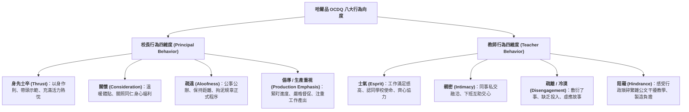
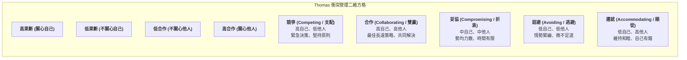

# 學校組織氣氛與衝突處理模式對照

## 一句話定位
> 學校組織運作的心理風貌稱為「組織氣氛」（以 Halpin & Croft 的 OCDQ 六大類型為經典代表）；而在動態運作中必然產生的利益與理念分歧，則依「衝突管理五策略」（Thomas 方格）進行調適。兩者皆為國小初試常客。

---

## 壹、 哈爾品與克羅夫特（Halpin & Croft）：OCDQ 組織氣氛六類型

哈爾品與克羅夫特（1963）編製**「組織氣候描述量表」（OCDQ）**，透過調查國小教師對「校長領導行為」與「教師互動行為」的感受，提煉出八個次向度，進而交叉組合出**六種組織氣氛型態**。

### 1. 測量次向度（校長 4 維度 + 教師 4 維度）

---

### 2. 六大組織氣氛型態深度對照表

從最健康、開放到最病態、封閉依序排列：

| 氣氛類型 | 校長主要行為特徵 | 教師主要行為特徵 | 組織特徵與教甄破題關鍵 |
| :--- | :--- | :--- | :--- |
| **1. 開放型 (Open Climate)** 🌟 最理想型態 | **高身先士卒、高關懷** 低疏遠、低倡導 不需過度嚴密監控，以身示範 | **高士氣、高親密** 低疏離、低阻礙 教師高度認同、真誠合作 | **真實、健康、高信任** 校長與教師兼顧「任務達成」與「需求滿足」，溝通無阻礙，教甄最佳首選答案。 |
| **2. 自主型 (Autonomous Climate)** | **低倡導、低疏遠、低身先士卒** 給予教師極大專業自主空間，校長退居幕後扮演行政支援 | **高士氣、高親密** 低疏離、低阻礙 教師展現高度專業成熟度，自主設定目標達成任務 | **無為而治、專業自律** 學校像大學或專業研究社群，校長充分授權信任，教師自我激勵。 |
| **3. 控制型 (Controlled Climate)** | **高倡導、高疏遠** 低身先士卒、低關懷 強烈以任務為導向、公事公辦、鐵腕治校 | **士氣中等偏低** **高阻礙**、低親密 教師疲於奔命於公文評鑑，感到行政造成沉重干擾負擔 | **冷酷無情、績效掛帥** 重做事不重做人，雖然具備工作效率，但缺乏人情溫暖與人際融洽。 |
| **4. 親密型 / 鄉愿型 (Familiar Climate)** | **高關懷**、低倡導 極力討好每個人、當好好先生、不願得罪人、不敢要求績效 | **高親密**、高疏離 **低士氣** 同仁一片和氣像大家庭，但私下都在聊天喝茶摸魚，正事無人過問 | **友善鄉愿、無績效** 重人際不重工作任務，人情關係大於一切，缺乏實質教學績效。 |
| **5. 父愛型 / 家長型 (Paternal Climate)** | **高倡導、高身先士卒** 高關懷、低疏遠 校長事必躬親、像慈父一樣無微不至但掌控一切 | **高疏離、高阻礙** **低士氣**、低親密 教師感到無能自主、被當作未成年小孩對待，產生抗拒不滿 | **家父長制、過度干預** 校長出發點是為教師好，但過度控制導致教師產生無力感與心理阻礙。 |
| **6. 封閉型 (Closed Climate)** ❌ 最病態型態 | **高疏遠、高倡導** 低身先士卒、低關懷 高高在上保持官僚距離、推託卸責、只看公文規章 | **高疏離、高阻礙** **低士氣、低親密** 教師互相猜忌防範、冷漠無情、各懷鬼胎、得過且過 | **虛偽、猜忌、士氣低落** 任務與需求雙雙落空，校園人際關係與行政效能全面崩潰。 |

---

## 貳、 湯瑪斯（Thomas & Kilmann）：衝突處理五策略

衝突是組織互動的常態。Kenneth Thomas 與 Ralph Kilmann 提出「衝突應對模式方格」，依據**兩個行為維度**進行交乘劃分：
1. **果斷性（Assertiveness）**：關心自己的利益（企圖滿足自己的目標與堅持）。
2. **合作性（Cooperativeness）**：關心他人的利益（企圖滿足對方的關切與需求）。

### 【Thomas 衝突處理策略深度解析表】

| 衝突策略 | 關心自己 vs 關心他人 | 核心行為模式 | 國小校務現場最佳適用情境 | 教甄題眼與關鍵字 |
| :--- | :---: | :--- | :--- | :--- |
| **1. 競爭型 (Competing)** | **高自己 低他人** | **強行貫徹、以權壓人** 追求贏過對方（零和賽局） | ① 校園遭遇突發火災、地震或重大危安事件（需立即拍板行動）。 ② 涉及重大法規遵循、性平通報、廉政倫理等**不可妥協之原則**。 ③ 必須推行極不受歡迎但攸關學校生存的必要改革。 | 緊急危機、重大原則、即刻決斷、不容妥協 |
| **2. 合作型 (Collaborating)** 🌟 最佳雙贏模式 | **高自己 高他人** | **坦誠深入溝通、整合雙方觀點** 追求雙贏（Win-Win） | ① 雙方目標都極為重要，任何一方妥協都不恰當。 ② 牽涉重大願景變革（如全校性 108 課綱校訂彈性課程研發）。 ③ 追求跨處室深度整合與團隊凝聚力。 | 雙贏、統合綜效、兼顧雙方關切、最佳策略 |
| **3. 妥協型 (Compromising)** | **中自己 中他人** | **互讓一步、利益對分** 尋求中間折衷平衡方案 | ① 雙方勢均力敵、互不相讓，且目標重要性相同。 ② 面對複雜問題，在有限的時間壓力下需達成暫行方案。 ③ 合作或競爭均宣告失敗時的次佳防線。 | 折衷、各退一步、勢均力敵、暫時性協議 |
| **4. 迴避型 (Avoiding)** | **低自己 低他人** | **裝作沒事、擱置拖延、退避三舍** 不面對處理 | ① 爭議議題瑣碎微不足道、或有更急迫的要事待辦。 ② 雙方情緒過度激動、非理性，需要暫時「冷卻情緒」。 ③ 搜集資訊不完整、時機未成熟，過早介入弊大於利。 | 冷卻情緒、微不足道、暫緩處理、爭取時間 |
| **5. 遷就型 / 順應型 (Accommodating)** | **低自己 高他人** | **犧牲小我、迎合對方、息事寧人** 滿足對方需求 | ① 發現自己確實判斷錯誤、對方立場正確。 ② 爭議對對方而言至關重要，但對自己而言影響不大。 ③ 長期和睦與信任關係高於眼前一時的短暫利益。 ④ 為了讓同仁從實作錯誤中學習成長。 | 息事寧人、維持和睦、自己理虧、長期人際優先 |

---

## 參、 龐迪（Pondy）：組織衝突動態演進五階段

組織衝突並非瞬間發生，而是經歷動態發展循環：
1. **潛伏期（Latent Conflict）**：根本起因潛伏於結構中（如資源競爭、目標分歧、職責重疊），尚未被當事人自覺。
2. **認知期（Perceived Conflict）**：意識到衝突的存在，理智上知道彼此存在矛盾（但情緒尚未受影響）。
3. **感受期（Felt Conflict）**：產生情緒焦慮、憤怒、緊繃與敵意（衝突個人化、情緒化）。
4. **顯現期（Manifest Conflict）**：衝突公然浮上檯面，轉化為口頭爭吵、公文阻撓、抗爭杯葛、肢體攻擊。
5. **餘波期（Conflict Aftermath）**：衝突解決後的後續效應；若處理得宜帶來健康變革與信任，若壓制掩蓋則埋下更嚴重的惡性循環種子。

---

## 國小教甄歷屆考點與陷阱提示

> [!TIP]
> 1. **OCDQ 氣氛配對題**：
>    - 「校長整天待在校長室簽公文、緊盯教師簽到退、不聞不問同仁困難；教師感到雜務繁多喘不過氣」 ➔ **控制型（Controlled）**。
>    - 「校長跟大家稱兄道弟、見面寒暄問暖，但從不敢指派艱鉅任務；同仁大家下班聚餐很開懷，但教學成果低落」 ➔ **親密型 / 鄉愿型（Familiar）**。
>    - 「校長像慈祥父親般無微不至，每件事都要親自指導過問，教師感到被當作不懂事的小孩無法發揮」 ➔ **父愛型 / 家長型（Paternal）**。
> 2. **Thomas 衝突策略情境題眼**：
>    - 「學校遭遇天然災害或校園重大性別事件通報」 ➔ 答案一律選 **競爭（貫徹法規、不可妥協）**！
>    - 「雙方情緒高度失控、現場氣氛火爆，校長決定先休會隔日再議」 ➔ 答案為 **迴避（降溫冷卻）**。
>    - 「針對專任教室排課時段，雙方皆有所堅持，最後決定每學期輪流抽籤」 ➔ 答案為 **妥協（各退一步）**。

---

## 出處與關聯詞條
- 專書出處：謝文全《教育行政學》第10章 組織氣氛與衝突、張春興《教育心理學》
- 關聯詞條：
  - [[教育領導理論演進與新型領導]]
  - [[教育領導理論大對照]]
  - [[工作激勵理論與組織行為]]
  - [[教育行政人物與口訣秒殺庫]]
