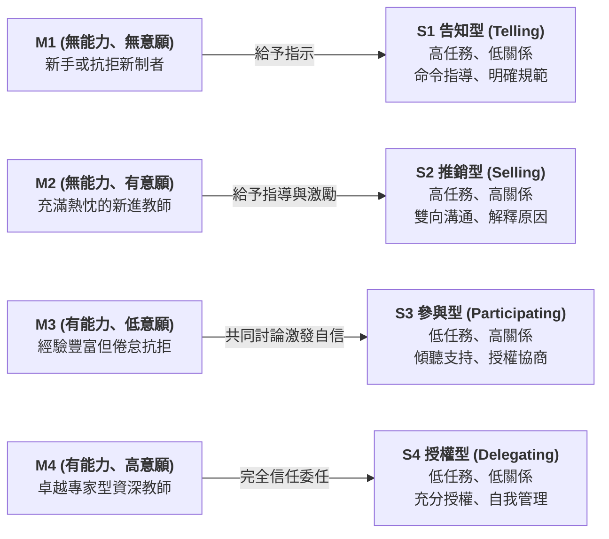

# 教育領導理論大對照

## 一句話定位
> 教育領導理論經歷「特質論 → 行為論 → 權變論 → 當代新興領導」百年演進，是國小教甄初試出題密度最高的考點區塊。

---

## 壹、 領導理論演進四階段全景對照

| 演進階段 | 年代 | 代表理論與學者 | 核心關注焦點 | 局限性與批判 |
| :--- | :--- | :--- | :--- | :--- |
| **特質論 (Trait Theory)** | 1900-1940 | 偉人理論 (Great Man Theory) Stogdill、Ghiselli | 領導者天生具備特殊的生理、智力、性格與社會特質 | 忽略後天培育、忽略部屬特質與情境脈絡互動 |
| **行為論 (Behavioral Theory)** | 1940-1960 | 俄亥俄大學（倡導 vs 關懷） Halpin 領導行為描述問卷（LBDQ） 密西根大學（員工導向 vs 生產導向） Blake & Mouton 管理格道理論 | 領導者的實際外顯行為風格（任務 vs 人際） | 未能解釋為何同一種領導行為在不同組織情境下成效天差地別 |
| **權變論 (Contingency Theory)** | 1960-1980 | Fiedler LPC 領導權變模式 House 路徑-目標理論（Path-Goal） Hersey & Blanchard 情境領導理論 Reddin 3D 領導理論 | 沒有一套放諸四海皆準的領導方式，效果取決於**「領導者風格與情境變數的適配度」** | 變數定義複雜、難以即時精準評估情境脈絡 |
| **當代新興領導 (Contemporary)** | 1980 至今 | Burns & Bass 轉型領導（Transformational） Greenleaf 僕人領導（Servant） Collins 第五級領導（Level 5） Gronn / Spillane 分散式領導（Distributed） Sergiovanni 道德領導 | 願景引導、道德感召、賦權增能、跨層級協作與意義建構 | 對領導者個人人格成熟度與組織文化要求極高 |

---

## 貳、 核心權變理論深度對照

### 1. 費德勒（Fiedler）：LPC 領導權變模式

- **核心量表**：最不受歡迎工作夥伴量表（Least Preferred Coworker, LPC）。
  - **高 LPC（$\ge 64$）**：關係導向（在最差同仁身上仍能看到優點，重視人際和諧）。
  - **低 LPC（$\le 57$）**：任務導向（對工作表現不佳同仁評價極低，專注達成工作目標）。
- **情境有利度三向度**（情境控制力由強至弱）：
  1. 領導者與成員關係（好 / 差）— 最重要向度。
  2. 任務結構（清楚明確 / 模糊不清）。
  3. 職位權力（強 / 弱）。

#### 【Fiedler 八種情境適配速查矩陣】
| 情境類型 | 領導者-成員關係 | 任務結構 | 職位權力 | 情境有利程度 | 最有效的領導風格 | 教甄口訣與題眼 |
| :---: | :---: | :---: | :---: | :---: | :---: | :--- |
| **第 1 類** | 良好 | 明確 | 強大 | **極度有利** | **低 LPC（任務導向）** | **「極好極壞選任務， 中間情境選人際」**  極度順遂或處境極度惡劣危機時，必須以任務明確推進！ |
| **第 2 類** | 良好 | 明確 | 弱小 | 有利 | **低 LPC（任務導向）** | |
| **第 3 類** | 良好 | 模糊 | 強大 | 有利 | **低 LPC（任務導向）** | |
| **第 4 類** | 良好 | 模糊 | 弱小 | **中度有利** | **高 LPC（關係導向）** | 中度有利時，組織充滿不確定性，需要依靠良好人際溝通化解疑慮、凝聚信任。 |
| **第 5 類** | 差勁 | 明確 | 強大 | **中度有利** | **高 LPC（關係導向）** | |
| **第 6 類** | 差勁 | 明確 | 弱小 | **中度有利** | **高 LPC（關係導向）** | |
| **第 7 類** | 差勁 | 模糊 | 強大 | 中度不利/混亂 | **高 LPC / 任務** | |
| **第 8 類** | 差勁 | 模糊 | 弱小 | **極度不利（危機）** | **低 LPC（任務導向）** | 陷入絕境、瀕臨崩潰或重大危機（如火災地震、校園重大抗爭），必須雷厲風行命令以求生存！ |

---

### 2. 赫西與布蘭查德（Hersey & Blanchard）：情境領導理論（Situational Leadership）

領導效能取決於部屬的**成熟度（Maturity / Readiness，工作能力 + 心理意願）**：

| 部屬成熟度階段 | 部屬能力與意願特徵 | 對應國小教師現場樣態 | 校長最佳領導風格（S1-S4） | 行為組合特徵 |
| :--- | :--- | :--- | :--- | :--- |
| **M1（低能力、低意願）** | 缺乏專業技能，且缺乏自信或抗拒執行 | 對新教學系統一竅不通且排斥的代課或不適任教師 | **S1 告知型（Telling / 指導型）** | **高任務、低關係** 明確指示做什麼、何時做、如何做，嚴格督導 |
| **M2（低能力、高意願）** | 專業尚不足，但充滿工作熱忱與學習動機 | 剛考上教甄的新進正式實習初任教師 | **S2 推銷型（Selling / 教導型）** | **高任務、高關係** 提供任務指導，同時給予情感激勵與價值說明 |
| **M3（高能力、低意願）** | 專業能力極強，但缺乏信心、動力不足或職業倦怠 | 資深但遭遇職業倦怠、不願接行政的資深優良教師 | **S3 參與型（Participating / 支持型）** | **低任務、高關係** 共同決策、加強情感支持、傾聽並肯定其專業 |
| **M4（高能力、高意願）** | 專業精湛，且具備高度責任感、自主積極 | 主任、學年主任、卓越輔導團輔導員 | **S4 授權型（Delegating / 委任型）** | **低任務、低關係** 給予自主發揮空間與資源，不作過多干預 |

---

### 3. 豪斯（House）：路徑-目標理論（Path-Goal Theory）
- 根基於 Vroom 的期望理論，領導者的核心任務在於**「釐清達成目標的路徑、掃除阻礙、增加部屬獲得個人滿意獎酬的機會」**。
- **四大領導行為**：
  1. **指示型（Directive）**：明確告知工作指引與標準（適用於任務模糊、部屬外控性格）。
  2. **支持型（Supportive）**：關心部屬福利與人際需求（適用於任務具重複性、挫折感重的情境）。
  3. **參與型（Participative）**：共同討論決策（適用於部屬內控性格、能力強的情境）。
  4. **成就取向型（Achievement-Oriented）**：設定高難度挑戰性目標、展現高度信任（適用於任務複雜非結構化、部屬追求成就感）。

---

## 參、 轉型領導 vs 互易領導深度對照

教甄歷屆考題中最核心的一對跨概念對照：

| 比較維度 | 轉型領導（Transformational Leadership） | 互易領導 / 交易領導（Transactional Leadership） |
| :--- | :--- | :--- |
| **代表學者** | **Burns（1978）、Bass（1985）** | **Burns（1978）、Bass（1985）** |
| **激勵層次** | 訴諸高層次需求（自我實現、社會使命感、道德倫理） | 訴諸低層次需求（生理安全、物質獎酬、利益交換） |
| **運作基石** | 追求「更高層次道德與價值觀的提升與轉變」 | 建立在「你給我工作、我給你薪酬獎賞」的契約交換 |
| **領導者角色** | 願景描繪者、精神導師、變革推動者（Change Agent） | 秩序維持者、管理者、合約監督者 |
| **核心組成向度** | **四大要素（4I）**： 1. **理想化影響力（Idealized Influence）**：以身作則、魅力典範。 2. **感召性激勵（Inspirational Motivation）**：勾勒鼓舞人心的遠大願景。 3. **智性啟發（Intellectual Stimulation）**：鼓勵打破傳統思維、反思創新。 4. **個別化關懷（Individualized Consideration）**：擔任導師教練、個別傾聽培力。 | **三大核心要素**： 1. **條件式獎酬（Contingent Reward）**：達到績效給予對等約定之報酬。 2. **主動例外管理（Active Management by Exception）**：事前緊盯規則、預先糾正偏差。 3. **被動例外管理（Passive Management by Exception）**：出差錯出包後才介入懲處。 |
| **組織結果** | 超越原有期望績效、高度組織公民行為、主動創新 | 達到標準預期績效、按部就班、缺乏自發超越突破 |

---

## 肆、 現代卓越校長領導新典範

| 領導型態 | 代表倡導者 | 核心概念與內涵 | 國小校務經營實例 |
| :--- | :--- | :--- | :--- |
| **第五級領導 (Level 5 Leadership)** | **柯林斯 (Jim Collins)** 《從優秀到卓越》 | **「謙虛的個性格局 + 專業的無比堅持（Humility + Will）」**。不居功自傲，將成就歸功於同仁與運氣，遇挫折攬全責。 | 校長默默在背後支持全校師生，將所有榮譽頒給教學團隊，自己甘居幕後。 |
| **僕人領導 (Servant Leadership)** | **格林里夫 (Robert Greenleaf)** | 領導者先是僕人，後是領導。以「服務他人」為首要導向，強調傾聽、同理、療癒、管家意識。 | 校長巡視校園協助打掃落葉、主動排解行政同仁備課物資困難，以服務取代權力施壓。 |
| **分散式領導 (Distributed Leadership)** | **斯皮蘭 (James Spillane) 格朗 (Peter Gronn)** | 領導不再專屬於單一「校長個體」，而是「領導者、追隨者與情境」三者動態互動的多重實踐網絡。 | 推動學年會議自主共備、教師專業學習社群（PLC）召集人輪流引領教學變革。 |
| **道德領導 (Moral Leadership)** | **薩鳩萬尼 (Thomas Sergiovanni)** | 組織不僅是理性科層，更是「道德共同體」。運用頭（理論反思）、心（價值信仰）、手（行政行動）。 | 建立以「學生最佳利益」為核心價值的校園倫理公約，教師發自內心遵守承諾。 |

---

## 國小教甄歷屆考點與陷阱指南

> [!WARNING]
> 1. **Fiedler LPC 陷阱**：
>    - 高 LPC 指的是「關係導向」（對最難搞同伴仍給高分，重人際）。
>    - 低 LPC 指的是「任務導向」（給難搞同伴打極低分，重績效）。
>    - 國小教甄最常考情境第 1 類與第 8 類：**「情境極度有利或極端惡劣不利時，任務導向（低 LPC）領導最有效！」**。
> 2. **Hersey & Blanchard M1-M4 配對陷阱**：
>    - 「初任教師充滿熱忱但專業技巧不足」 ➔ 屬於 M2（意願高、能力低），應採 **S2 推銷型（教導型，高任務、高關係）**，切莫誤選 S1！
>    - 「資深教師技術精湛但遭遇倦怠缺乏意願」 ➔ 屬於 M3（意願低、能力高），應採 **S3 參與型（支持型，低任務、高關係）**。
> 3. **4I 構面題幹關鍵字對應**：
>    - 校長「以身作則、展現高尚品德風範」 ➔ **理想化影響力（Idealized Influence）**。
>    - 校長「向全校描繪宏偉願景、鼓舞全體士氣」 ➔ **感召性激勵（Inspirational Motivation）**。
>    - 校長「鼓勵同仁顛覆舊思維、設計創新跨領域教案」 ➔ **智性啟發（Intellectual Stimulation）**。
>    - 校長「針對個別新進教師進行一對一輔導諮商與專業培力」 ➔ **個別化關懷（Individualized Consideration）**。

---

## 出處與關聯詞條
- 專書出處：謝文全《教育行政學》第9章 激勵與領導、秦夢群《教育領導理論與實務》
- 關聯詞條：
  - [[教育領導理論演進與新型領導]]
  - [[工作激勵理論與組織行為]]
  - [[學校組織氣氛與衝突處理模式對照]]
  - [[教育行政人物與口訣秒殺庫]]
