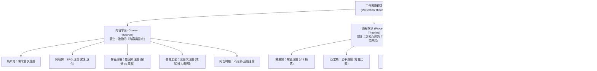
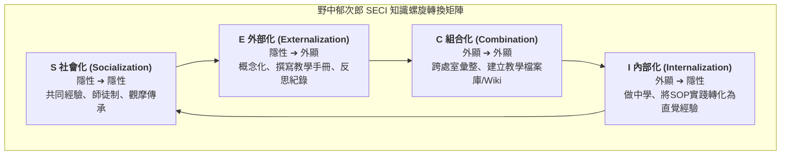

# 工作激勵理論與組織行為

## 一句話定位
> 探討學校成員工作動機之誘發、導向與持續機制，劃分為「內容學派」（滿足何種需求）與「過程學派」（如何產生激勵），是國小校長領導、教師士氣提升與行政效能的核心考點。

---

## 核心理論架構：內容學派 vs 過程學派

---

## 壹、 內容學派（Content Theories：滿足何種需求）

內容學派重點在於找出**「引發個體行為的具體內在需求與刺激因素」**。

### 1. 馬斯洛（Abraham Maslow）：需求層次理論（Hierarchy of Needs）
- **五大基本層次**（由低至高階梯式發展）：
  1. **生理需求（Physiological）**：飲食、睡眠、基本薪資、休息。
  2. **安全需求（Safety）**：人身安全、工作保障、退休金制度、健康保險。
  3. **愛與歸屬需求（Belongingness/Social）**：同事友誼、團隊融洽、校園歸屬感。
  4. **尊重需求（Esteem）**：自尊、同儕認可、社會地位、被表彰。
  5. **自我實現需求（Self-Actualization）**：發揮潛能、實現理想、個人成就高峰。
- **後期補充七層次**：在尊重與自我實現之間加入**求知需求（Cognitive）**與**求美需求（Aesthetic）**；最頂層擴充為**超越自我需求（Self-Transcendence）**。
- **考點核心法則**：低層次需求滿足後，高層次需求才會成為主導動機（滿意前進原則）。只有在匱乏時產生動機者為「匱乏需求（Deficiency Needs，前四層）」；追求成長者為「成長需求（Growth Needs，後三層）」。

### 2. 阿德佛（Clayton Alderfer）：ERG 理論
為修正馬斯洛理論在職場中的僵化限制而提出三大核心需求：
- **E（Existence）生存需求**：相當於生理與安全需求（工資、工作環境）。
- **R（Relatedness）關係需求**：相當於愛與歸屬、部分尊重需求（人際互動）。
- **G（Growth）成長需求**：相當於尊重與自我實現需求（創造力、專業成長）。
- **教甄必考重大差異**：
  - **多元並存**：不同需求可**同時**存在並發揮激勵作用，不需嚴格階梯順序。
  - **挫折-退化機制（Frustration-Regression）**：當高層次需求受挫無法滿足時，個體會退回更強烈追求低層次需求（例如教師專業成長受阻時，轉而極端計較排課時數或津貼分配）。

### 3. 赫茲伯格（Frederick Herzberg）：雙因素理論（Dual-Factor Theory / 激勵保健理論）
認為「滿意的反面不是不滿意，而是沒有滿意」；「不滿意的反面不是滿意，而是沒有不滿意」。

| 因素分類 | 涵蓋內容（工作脈絡 vs 工作本身） | 滿足後的作用 | 缺乏時的後果 | 代表項目 |
| :--- | :--- | :--- | :--- | :--- |
| **保健因素 (Hygiene Factors)** | **工作外在環境 / 工作脈絡 (Context)** 維持現狀，防止不滿意產生 | 消除不滿意 （達到「沒有不滿意」） | 產生強烈不滿意與士氣低落 | 薪資待遇、學校政策、人際關係、工作環境、監督品質、職位安定 |
| **激勵因素 (Motivator Factors)** | **工作內在性質 / 工作本身 (Content)** 真正能激發高昂士氣與潛能 | 帶來高度滿意 （達到「滿意」狀態） | 僅為「沒有滿意」 不會直接導致不滿意 | 成就感、受肯定讚賞、工作本身挑戰性、責任感、專業成長與升遷發展 |

- **學校行政實踐**：
  - **工作豐富化（Job Enrichment）**：垂直擴充職權，增加責任與自主權（屬於激勵因素）。
  - **工作擴大化（Job Enlargement）**：水平擴大工作項目，增加不同工作多樣性（通常仍屬保健範疇）。

### 4. 麥克里蘭（David McClelland）：成就需求理論（Acquired Needs Theory）
主張人類行為動機透過文化與經驗習得，主要由三種需求構成（以主題統覺測驗 TAT 評估）：
1. **成就需求（Need for Achievement, nAch）**：渴望克服困難、追求卓越、解決高難度問題。喜好具挑戰性但成功率約 50% 的中等風險任務，渴望即時回饋。
2. **權力需求（Need for Power, nPow）**：渴望影響、指導、控制他人，重視地位與權威。優秀的行政主管通常具備高社會化權力需求。
3. **親和/歸屬需求（Need for Affiliation, nAff）**：渴望建立良好人際關係、被他人接納喜愛、避免衝突。

### 5. 阿吉利斯（Chris Argyris）：不成熟-成熟理論（Immaturity-Maturity Theory）
- 個體在身心發展歷程中，會從「依賴、被動、短視、缺乏自覺的不成熟狀態」，走向「獨立、主動、長期深遠、高度自我意識的成熟狀態」。
- **批判**：傳統官僚科層體制的嚴格層級節制與死板規定，常迫使心理成熟的成年教師退化為被動不成熟狀態；主張實施參與管理與職權擴大。

---

## 貳、 過程學派（Process Theories：如何產生激勵）

過程學派著重探討**「動機產生的認知心智過程、個體的預期評估與比較心理」**。

### 1. 佛洛姆（Victor Vroom）：期望理論（Expectancy Theory / VIE 模式）
激勵力量取決於三大變項的相乘效果，公式為：

> **【激勵力量公式】動機力量 (Motivation, M) = 期望 (Expectancy, E) × 媒介/工具性 (Instrumentality, I) × 效價 (Valence, V)**

- **期望（Expectancy, E → P）**：努力與績效的關聯。個人主觀相信「只要我努力付諸行動，是否能達到預期績效目標？」（機率值介於 0 ~ 1）。
- **媒介/工具性（Instrumentality, P → O）**：績效與獎酬的關聯。個人相信「一旦達到目標績效，組織是否真會兌現給予承諾的報酬？」（介於 -1 ~ +1 或 0 ~ 1）。
- **效價（Valence, V）**：獎酬的吸引力價值。組織所給予的報酬對個體本身是否具有高度吸引力與價值？（可能為正、零或負值）。
- **教甄口訣與破題**：任一變項若為零，整體激勵力量即為零！學校領導者必須：
  1. 提供增能研習與資源，提升教師「努力即能達成績效」的**期望**。
  2. 說話算話、制度透明，提升「績效必得獎酬」的**媒介性**。
  3. 投其所好、因人而異，給予教師真正看重的**效價**（如公開表揚或進修機會，而非只是形式獎品）。

### 2. 亞當斯（J. Stacy Adams）：公平理論（Equity Theory）
源自 Leon Festinger 的「認知失調論」，強調個體透過**社會比較（Social Comparison）**感受主觀公平性：

> **【公平公式】個人評估：（自己的產出 / 自己的投入）與（對照對象的產出 / 對照對象的投入）之相對比值**

- **投入（Inputs）**：努力、年資、學歷、時間、專業技能。
- **產出（Outcomes）**：薪資、獎金、職位、榮譽、排課優待、校長賞識。
- **不公平感的心理反應與消除行為**：
  1. **改變自己的投入**（自認少拿報酬就減少努力、摸魚打混）。
  2. **改變自己的產出**（爭取兼職補貼或排課優惠）。
  3. **扭曲對自我的認知**（自我安慰「其實我做得很輕鬆，本該拿較少」）。
  4. **扭曲對他人的認知**（認為對方「其實承擔了更多不為人知的壓力」）。
  5. **改變參考對象**（不再與同組王老師比，改跟其他學校比）。
  6. **退出工作場域**（調校、離職、辭去行政職）。

### 3. 洛克（Edwin Locke）：目標設定理論（Goal-Setting Theory）
- 目標是引導個體行動的方向舵。
- **高激勵效果目標的特質**：
  - **明確具體（Specific）**：比「盡力而為（Do your best）」更能激發高績效。
  - **具適度挑戰性（Challenging）**：難度高但經努力可達成者，績效最高。
  - **目標接受與承諾（Commitment）**：教師若親自參與目標設定，承諾感更高。
  - **即時回饋（Feedback）**：提供過程中的明確回饋，指引努力修正方向。

### 4. 波特與勞勒（Porter & Lawler）：綜合激勵模式
- 整合了期望理論、公平理論與滿意度。
- **核心顛覆觀點**：傳統認為「工作滿意會帶來高績效」；Porter & Lawler 實證指出**「良好的工作績效，透過合理的內外在獎酬及個體感受到的公平性，才會導致滿意度（Performance leads to Satisfaction）！」**。

---

## 參、 現代組織行為與知識管理

### 1. 組織公民行為（Organizational Citizenship Behavior, OCB）
由 **Dennis Organ** 提出，指員工超越工作合約角色規範（Extra-Role），自發從事有益於組織運作與同仁的利他行為，且無法在正式薪酬系統中得到直接回饋。
- **五大核心構面（教甄高頻必考）**：
  1. **利他行為（Altruism）**：主動協助特定同仁解決教學或班級突發問題。
  2. **良心認真 / 盡職行為（Conscientiousness）**：超越基本規章要求的敬業精神（如自主提早到校巡查、維持備課水準）。
  3. **運動員精神 / 容忍（Sportsmanship）**：遭遇體制不便或挫折時不怨天尤人、展現寬容樂觀正向態度。
  4. **禮貌周到 / 敦睦（Courtesy）**：事前主動溝通、尊重同仁權益，防止爭端或業務衝突發生。
  5. **公民美德（Civic Virtue）**：積極參與學校各項公共事務（主動出席各項會議、維護學校聲譽）。

### 2. 野中郁次郎（Ikujiro Nonaka）：SECI 知識創造螺旋
組織智慧的核心在於**「隱性知識（Tacit Knowledge）」**與**「外顯知識（Explicit Knowledge）」**的動態轉化：

| 轉化模式 | 知識轉換向度 | 教育現場具體實踐 | 教甄破題關鍵字 |
| :--- | :--- | :--- | :--- |
| **社會化 (Socialization)** | **隱性 ➔ 隱性** | 資深教師帶領薪傳教師（薪傳制）、公開授課觀摩、非正式茶敘經驗分享 | 師徒制、默會知識、共同經驗、觀察模仿 |
| **外部化 (Externalization)** | **隱性 ➔ 外顯** | 教師將教學巧門、班經心法編寫成教案、輔導案例手冊、反思日誌 | 概念化、撰寫手冊、文字化、隱性轉外顯 |
| **組合化 (Combination)** | **外顯 ➔ 外顯** | 彙整各學年教案建立雲端資源庫、統整各處室行政規章製作校務 Wiki | 整併資料、系統化、重新組合分類、資料庫 |
| **內部化 (Internalization)** | **外顯 ➔ 隱性** | 閱讀新課綱指引手冊後實際於課堂教學實踐，轉化為自身專業直覺與技巧 | 做中學、消化吸收、內化為心智模式、實踐應用 |

### 3. 彼得·聖吉（Peter Senge）：《第五項修練》學習型組織（Learning Organization）
學習型組織是能夠持續轉化自我、因應變革的有機體，五大修練為：
1. **自我超越（Personal Mastery）**：擴展個人能力、專注於真正關切的目標。
2. **改善心智模式（Improving Mental Models）**：反思並破除內心根深蒂固的假設與偏見。
3. **建立共同願景（Building Shared Vision）**：由下而上凝聚成員共享的組織未來藍圖。
4. **團隊學習（Team Learning）**：透過深度匯談（Dialogue）達成組織智慧超越個人總和。
5. **系統思考（Systems Thinking）**：**第五項修練（核心修練）**，見樹又見林，從整體動態因果回饋視角洞悉問題本質。

---

## 國小教甄歷屆考點與陷阱提示

> [!TIP]
> 1. **馬斯洛 vs 阿德佛（ERG）考點**：
>    - 題幹提到「某教師在教學成長受阻時，轉而要求增加超鐘點費與硬體配備」，此為阿德佛的**「挫折-退化（Frustration-Regression）」**機制。
>    - 馬斯洛只認同「由低到高（滿足-前進）」，絕無退化路徑。
> 2. **赫茲伯格「雙因素」考點**：
>    - 加薪、改善教師辦公室冷氣、校長和顏悅色 ➔ 只能**消除不滿（保健因素）**，無法真正激發教師的工作熱忱！
>    - 想要教師自主研發特色課程、投入教學創新 ➔ 必須提供**成就感、責任與自主權（激勵因素）**。
> 3. **佛洛姆期望理論（VIE）相乘陷阱**：
>    - 題幹：「校長承諾如果各班學力測驗進步，就頒發每人獎金十萬元；但全體老師皆知校務基金根本無此預算」 ➔ 此時為**工具性/媒介性（Instrumentality）趨近於零**，激勵無效！
> 4. **Dennis Organ 組織公民行為（OCB）五大維度**：
>    - 「主動協助生病同事代課代導」 ➔ **利他行為**。
>    - 「遇到行政推動困難時不抱怨、以正面態度面對」 ➔ **運動員精神（容忍）**。
>    - 「跨處室活動前主動知會相關同仁避免衝堂」 ➔ **禮貌周到（敦睦）**。

---

## 出處與關聯詞條
- 專書出處：張春興《教育心理學》、謝文全《教育行政學》第9章 激勵與領導、秦夢群《教育行政理論與實務》
- 關聯詞條：
  - [[教育領導理論演進與新型領導]]
  - [[學校組織理論與型態分類]]
  - [[學校組織氣氛與衝突處理模式對照]]
  - [[教育行政人物與口訣秒殺庫]]
